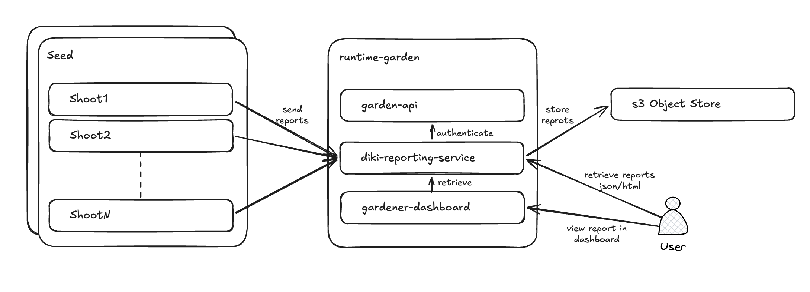

# Diki-reporting-service



Implement `diki-reporting-service`, an HTTP service that allows [diki](https://github.com/gardener/diki) scan jobs to push compliance-scan reports to S3-compatible object storage, and provides operators and dashboards a way to retrieve those reports — raw, as JSON, or rendered as HTML — with access gated by the caller's existing Gardener RBAC permissions, verified via SubjectAccessReview against the garden cluster.

Two endpoints, served on **separate ports with distinct trust models** (plus a plain-HTTP health port):

| Port | Endpoint | Transport / auth |
|------|----------|------------------|
| `:8443` | `POST .../reports` (ingest) | **mTLS** — client cert signed by the configured ingest CA is the sole credential |
| `:8444` | `GET .../reports` (fetch) | **TLS** + per-caller Gardener RBAC via SubjectAccessReview |
| `:8080` | `GET /healthz` | plain HTTP, unauthenticated |

**Example configuration:**
```yaml
apiVersion: config.service.diki.gardener.cloud/v1alpha1
kind: ReportingServiceConfiguration
server:
  ingest:                          # POST — mutual TLS; client cert is the sole credential
    bindAddress: ":8443"
    tlsCertFile: /etc/diki/ingest-tls.crt
    tlsKeyFile: /etc/diki/ingest-tls.key
    clientCAFile: /etc/diki/client-ca.crt
  fetch:                           # GET — server-side TLS; per-caller SAR authorization
    bindAddress: ":8444"
    tlsCertFile: /etc/diki/fetch-tls.crt
    tlsKeyFile: /etc/diki/fetch-tls.key
  health:                          # /healthz — plain HTTP
    bindAddress: ":8080"
garden:
  # kubeconfig for the garden cluster (for SubjectAccessReview). Empty = in-cluster.
  kubeconfigPath: /etc/diki/garden-kubeconfig
```

---

## POST /v1/{project_name}/{project_uid}/{shoot_name}/{shoot_uid}/reports

Ingest a diki compliance-scan report. Port `:8443`.

**Authentication:** mutual TLS — the caller (a diki-exporter) must present a client certificate signed by the ingest client CA. No bearer token or API key.

> [!NOTE]
> Ingest currently authenticates "a trusted diki-exporter" (any CA-signed client cert), not *which* exporter. Making exporters individually identifiable has two options, both flawed:
> 1. **Cluster JWT** — the exporter presents its ServiceAccount token, verified against the shoot's apiserver. Flaw: the reporting service (runtime cluster) would need to reach/authenticate against each shoot apiserver.
> 2. **Per-exporter SAN in the client certificate** — encode the exporter identity in the cert. Flaw: the diki extension would need the CA signing key to mint per-exporter certs, spreading the CA key to every seed.

**Headers:**
- `Content-Type: application/json`
- `Content-Encoding: gzip` *(required — the body must be a gzip-compressed JSON report)*

**Request body** (gzip-compressed JSON):
```json
{
  "scanID": "scan-2026-09-25",
  "report": { ...diki report JSON... }
}
```

> [!NOTE]
> Alternatively, the body could be **only the diki report** (no `scanID`), and the reporting-service would generate the scan ID itself and return it in the response.

**Responses:**
- `201 Created` — `{"key": "my-project/proj-uid-456/my-shoot/uid-123/scan-2026-09-25.json.gz"}`
- `400 Bad Request` — missing scanID/report, body not gzip, or decompressed body not valid JSON
- `500 Internal Server Error` — storage failure

---

## GET /v1/{project_name}/{project_uid}/{shoot_name}/{shoot_uid}/reports

List all scan IDs stored for a shoot, or retrieve a specific report. Port `:8444`.

**Authentication:** `Authorization: Bearer <token>` — a **garden-apiserver token** (Gardener user or dashboard forwarding the user's token). The service verifies the project/shoot UIDs against the garden objects and runs a SubjectAccessReview (`get shoots`) against the garden cluster as the caller. Returns `403 Forbidden` if the check or a UID match fails.

**Query parameters:**
- *(none)* — list all scan IDs
- `scanID=scan-001` — retrieve a specific report
- `latest=true` — retrieve the most recently stored report

**Responses (list):**
- `200 OK`
  ```json
  {
    "project": { "name": "my-project", "uid": "proj-uid-456" },
    "shoot":   { "name": "my-shoot",   "uid": "uid-123" },
    "scans":   ["scan-001", "scan-002"]
  }
  ```

**Responses (retrieve):**

Format is controlled by the `Accept` header:

| Accept header                | Response body                        |
|------------------------------|--------------------------------------|
| `application/gzip` (default) | Raw gzip-compressed report           |
| `application/json`           | Decompressed diki report JSON        |
| `text/html`                  | HTML rendered via diki HTMLRenderer  |

**Responses:**
- `200 OK` — report or scan list
- `400 Bad Request` — `scanID` and `latest=true` both provided
- `401 Unauthorized` — missing or invalid bearer token
- `403 Forbidden` — SubjectAccessReview denied
- `404 Not Found` — scan does not exist, or no reports exist for this shoot
- `500 Internal Server Error` — storage or rendering failure

**Examples:**
```bash
# list all scans
curl -H "Authorization: Bearer $TOKEN" https://localhost:8444/v1/my-project/proj-uid-456/my-shoot/uid-123/reports

# specific scan, JSON
curl -H "Authorization: Bearer $TOKEN" -H "Accept: application/json" "https://localhost:8444/v1/my-project/proj-uid-456/my-shoot/uid-123/reports?scanID=scan-001"

# latest report, HTML
curl -H "Authorization: Bearer $TOKEN" -H "Accept: text/html" "https://localhost:8444/v1/my-project/proj-uid-456/my-shoot/uid-123/reports?latest=true"
```
