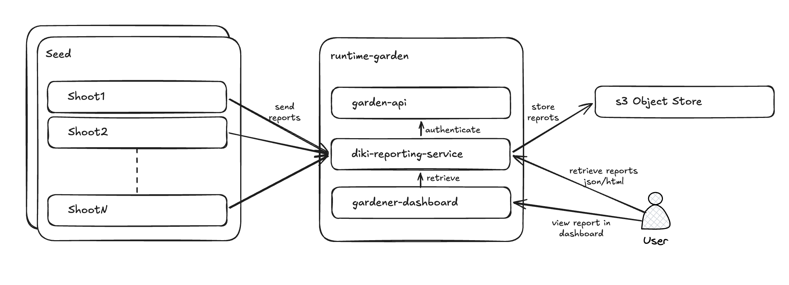

# Diki-reporting-service



Implement `diki-reporting-service`, an HTTP service that allows [diki](https://github.com/gardener/diki) scan jobs to push compliance-scan reports to S3-compatible object storage, and provides operators and dashboards a way to retrieve those reports — raw, as JSON, or rendered as HTML — with access gated by the caller's existing Gardener RBAC permissions, verified via SubjectAccessReview against the garden cluster.

Two endpoints, served on **separate ports with distinct trust models** (plus a plain-HTTP health port):

| Port | Endpoint | Transport / auth |
|------|----------|------------------|
| `:8443` | `POST .../reports` (ingest) | **mTLS** + optional **Gardener WorkloadIdentity JWT** for per-shoot identity |
| `:8444` | `GET .../reports` (fetch) | **TLS** + per-caller Gardener RBAC via SubjectAccessReview |
| `:8080` | `GET /healthz` | plain HTTP, unauthenticated |

**Example configuration:**
```yaml
apiVersion: config.service.diki.gardener.cloud/v1alpha1
kind: ReportingServiceConfiguration
server:
  ingest:                          # POST — mutual TLS + optional WorkloadIdentity JWT
    bindAddress: ":8443"
    tlsCertFile: /etc/diki/ingest-tls.crt
    tlsKeyFile: /etc/diki/ingest-tls.key
    clientCAFile: /etc/diki/client-ca.crt
    # Optional: per-shoot identity verification via Gardener WorkloadIdentity JWTs.
    # When set, exporters must present a JWT whose shoot/project claims match the URL path.
    # When omitted, ingest runs mTLS-only (no per-shoot identity check).
    workloadIdentity:
      # Gardener WorkloadIdentity issuer URL — the exact "iss" claim of the tokens.
      # JWKS is fetched from {issuer}/jwks for local signature verification.
      issuer: https://discovery.ingress.garden.example.com/garden/workload-identity/issuer
      # Acceptable "aud" claim values. The WorkloadIdentity resource in the garden
      # cluster must include one of these in spec.audiences.
      audiences:
        - diki-reporting-service
      # WorkloadIdentity resources whose JWTs are accepted. Each entry's name and
      # namespace must match the "gardener.cloud.workloadIdentity" claim in the JWT.
      allowedIdentities:
        - name: my-wi-resource
          namespace: garden
  fetch:                           # GET — server-side TLS; per-caller SAR authorization
    bindAddress: ":8444"
    tlsCertFile: /etc/diki/fetch-tls.crt
    tlsKeyFile: /etc/diki/fetch-tls.key
  health:                          # /healthz — plain HTTP
    bindAddress: ":8080"
garden:
  # kubeconfig for the garden cluster (for SubjectAccessReview). Empty = in-cluster.
  kubeconfigPath: /etc/diki/garden-kubeconfig
objectStore:
  s3:
    bucket: bucket-name
    # AWS region or S3-compatible region.
    region: eu-west-1
    # Custom S3-compatible endpoint (e.g., Ceph RGW or MinIO). When set, path-style
    # addressing is enabled and SDK checksum trailers are disabled. Leave empty for AWS S3.
    endpoint: https://s3.example.com
    # Path to an AWS-style credentials file (INI format with aws_access_key_id and
    # aws_secret_access_key).
    credentialsFile: /etc/diki/s3-credentials
```

---

## POST /v1/{project_name}/{project_uid}/{shoot_name}/{shoot_uid}/reports

Ingest a diki compliance-scan report. Port `:8443`.

### Authentication

**Transport layer — mTLS:** The caller (a diki-exporter) must present a client certificate signed by the ingest client CA. This authenticates the caller as "a trusted diki-exporter."

**Application layer — Gardener WorkloadIdentity JWT (optional):** When `workloadIdentity` is configured, the exporter must additionally present an `Authorization: Bearer <token>` header containing a Gardener WorkloadIdentity JWT. The service validates:

1. **Signature** — verified locally against the JWKS fetched from the configured issuer
2. **Standard claims** — `exp` (not expired), `iss` (matches configured issuer), `aud` (intersection with configured audiences)
3. **Allowed identity** — `gardener.cloud.workloadIdentity` claim (name + namespace) must match one of the configured `allowedIdentities`
4. **Shoot/project identity** — `gardener.cloud.shoot.{name,uid}` and `gardener.cloud.project.{name,uid}` must match the URL path parameters

This ensures a shoot's exporter can only write reports under its own path. When `workloadIdentity` is omitted from the config, ingest runs mTLS-only (backward compatible).

### Garden-side prerequisites for WorkloadIdentity

1. **Create a `WorkloadIdentity` resource** in the garden cluster (e.g. in `garden` project):
   ```yaml
   apiVersion: security.gardener.cloud/v1alpha1
   kind: WorkloadIdentity
   metadata:
     name: my-wi-resource
     namespace: garden
   spec:
     audiences:
       - diki-reporting-service
     targetSystem:
       type: diki-reporting-service
   ```

2. **Grant gardenlets permission** to request tokens for the WorkloadIdentity:
   ```yaml
   apiVersion: rbac.authorization.k8s.io/v1
   kind: Role
   metadata:
     name: my-wi-resource:wi-token-requestor
     namespace: garden
   rules:
     - apiGroups:
         - security.gardener.cloud
       resources:
         - workloadidentities/token
       resourceNames:
         - my-wi-resource
       verbs:
         - create
   ---
   apiVersion: rbac.authorization.k8s.io/v1
   kind: RoleBinding
   metadata:
     name: my-wi-resource:wi-token-requestor:seeds
     namespace: garden
   roleRef:
     apiGroup: rbac.authorization.k8s.io
     kind: Role
     name: my-wi-resource:wi-token-requestor
   subjects:
     - apiGroup: rbac.authorization.k8s.io
       kind: Group
       name: gardener.cloud:system:seeds
   ```

3. **Create a token-requestor Secret** in the shoot's seed namespace so the gardenlet mints JWTs:
   ```yaml
   apiVersion: v1
   kind: Secret
   metadata:
     name: my-wi-resource
     namespace: shoot--my-project--my-shoot
     labels:
       security.gardener.cloud/purpose: workload-identity-token-requestor
     annotations:
       workloadidentity.security.gardener.cloud/name: my-wi-resource
       workloadidentity.security.gardener.cloud/namespace: garden
       workloadidentity.security.gardener.cloud/context-object: |
         {"kind":"Shoot","apiVersion":"core.gardener.cloud/v1beta1",
          "name":"my-shoot","namespace":"garden-my-project",
          "uid":"<shoot-uid>"}
   type: Opaque
   ```

### Headers

- `Content-Type: application/json`
- `Content-Encoding: gzip` *(required — the body must be a gzip-compressed JSON report)*
- `Authorization: Bearer <workload-identity-jwt>` *(required when `workloadIdentity` is configured)*

### Request body (gzip-compressed JSON)

```json
{
  "scanID": "scan-2026-09-25",
  "report": { ...diki report JSON... }
}
```

> [!NOTE]
> Alternatively, the body could be **only the diki report** (no `scanID`), and the reporting-service would generate the scan ID itself and return it in the response.

### Responses

- `201 Created` — `{"key": "my-project/proj-uid-456/my-shoot/uid-123/scan-2026-09-25.json.gz"}`
- `400 Bad Request` — missing scanID/report, body not gzip, or decompressed body not valid JSON
- `401 Unauthorized` — missing or invalid JWT (when WorkloadIdentity is configured)
- `403 Forbidden` — JWT claims don't match the URL path, or workload identity not allowed
- `500 Internal Server Error` — storage failure

---

## GET /v1/{project_name}/{project_uid}/{shoot_name}/{shoot_uid}/reports

List all scan IDs stored for a shoot, or retrieve a specific report. Port `:8444`.

### Authentication

`Authorization: Bearer <token>` — a **garden-apiserver token** (Gardener user or dashboard forwarding the user's token). The service verifies the project/shoot UIDs against the garden objects and runs a SubjectAccessReview (`get shoots`) against the garden cluster as the caller. Returns `403 Forbidden` if the check or a UID match fails.

### Query parameters

- *(none)* — list all scan IDs
- `scanID=scan-001` — retrieve a specific report
- `latest=true` — retrieve the most recently stored report

### Responses (list)

- `200 OK`
  ```json
  {
    "project": { "name": "my-project", "uid": "proj-uid-456" },
    "shoot":   { "name": "my-shoot",   "uid": "uid-123" },
    "scans":   ["scan-001", "scan-002"]
  }
  ```

### Responses (retrieve)

Format is controlled by the `Accept` header:

| Accept header                | Response body                        |
|------------------------------|--------------------------------------|
| `application/gzip` (default) | Raw gzip-compressed report           |
| `application/json`           | Decompressed diki report JSON        |
| `text/html`                  | HTML rendered via diki HTMLRenderer  |

### Response codes

- `200 OK` — report or scan list
- `400 Bad Request` — `scanID` and `latest=true` both provided
- `401 Unauthorized` — missing or invalid bearer token
- `403 Forbidden` — SubjectAccessReview denied
- `404 Not Found` — scan does not exist, or no reports exist for this shoot
- `500 Internal Server Error` — storage or rendering failure

### Examples
```bash
# list all scans
curl -H "Authorization: Bearer $TOKEN" https://localhost:8444/v1/my-project/proj-uid-456/my-shoot/uid-123/reports

# specific scan, JSON
curl -H "Authorization: Bearer $TOKEN" -H "Accept: application/json" "https://localhost:8444/v1/my-project/proj-uid-456/my-shoot/uid-123/reports?scanID=scan-001"

# latest report, HTML
curl -H "Authorization: Bearer $TOKEN" -H "Accept: text/html" "https://localhost:8444/v1/my-project/proj-uid-456/my-shoot/uid-123/reports?latest=true"
```
