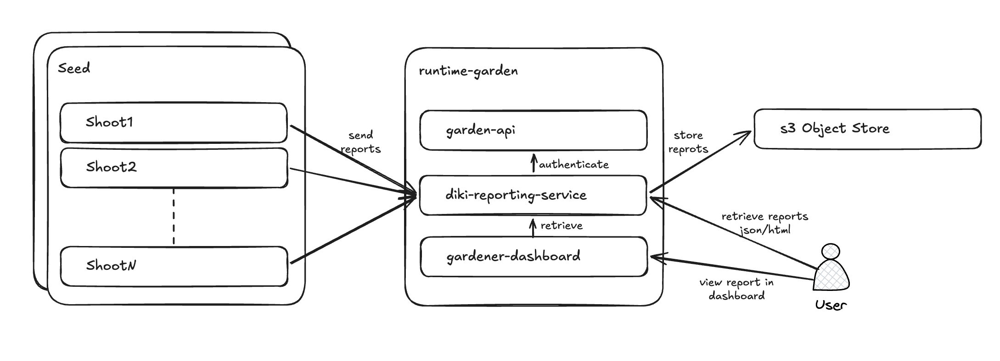

# Diki-reporting-service



Implement `diki-reporting-service`, an HTTP service that allows [diki](https://github.com/gardener/diki) scan jobs to push compliance-scan reports to S3-compatible object storage, and provides operators and dashboards a way to retrieve those reports as JSON, with access gated by the caller's existing Gardener RBAC permissions.

- **Ingest** is authenticated by a Gardener `WorkloadIdentity` (WI) JWT over server TLS. The shoot and project identity is derived from the token claims, not from the URL.
- **Retrieve** is authenticated by a garden user token and authorized via `SubjectAccessReview` against a virtual resource `dikireports.authorization.extensions.gardener.cloud`.

The service runs in the runtime garden cluster and can be deployed as part of the garden-class runtime charts.

Two listeners:

| Port | Endpoint | Transport / auth |
|------|----------|------------------|
| `:8443` | API: `PUT .../reports/{id}` (ingest), `GET .../reports` (retrieve) | **TLS** + WI JWT (ingest) / garden user token + SAR (retrieve) |
| `:8080` | `GET /healthz` `/readyz` `/metrics` | plain HTTP, cluster-internal, unauthenticated |

Ingest and retrieve share one TLS listener. They differ only in how the bearer token is verified, and the two token types cannot be confused: a WI JWT fails `TokenReview` (the virtual garden does not accept the WI issuer), and a user token fails JWKS verification and the `aud` check.

**Example configuration:**
```yaml
apiVersion: config.service.diki.gardener.cloud/v1alpha1
kind: ReportingServiceConfiguration
server:
  api:                     # ingest (PUT) + retrieve (GET), server-side TLS
    bindAddress: ":8443"
    tlsCertFile: /etc/diki/tls.crt
    tlsKeyFile: /etc/diki/tls.key
  health:                  # /healthz, /readyz, /metrics; cluster-internal, plain HTTP
    bindAddress: ":8080"
auth:
  workloadIdentity:        # ingest; mandatory
    # Gardener WorkloadIdentity issuer URL — the exact "iss" claim of the tokens.
    issuer: https://discovery.ingress.garden.example.com/garden/workload-identity/issuer
    # Acceptable "aud" values. The WorkloadIdentity resource must list one in spec.audiences.
    audiences:
      - diki-reporting-service
    # WorkloadIdentity whose JWTs are accepted (namespace is always `garden`).
    # Security-critical.
    allowedIdentities:
      - namespace: garden
        name: diki-reporting-service
        uid: <workload-identity-uid>
  garden:                  # retrieve; TokenReview + SubjectAccessReview
    kubeconfigPath: /etc/diki/garden-kubeconfig
objectStore:
  s3:
    bucket: diki-reports
    region: eu-west-1
    # Custom S3-compatible endpoint (Ceph RGW, MinIO). When set, path-style addressing
    # is enabled and SDK checksum trailers are disabled. Leave empty for AWS S3.
    endpoint: https://s3.example.com
    # AWS-style credentials file (INI with aws_access_key_id / aws_secret_access_key).
    credentialsFile: /etc/diki/s3-credentials
```

---

## Identity: WorkloadIdentity

Ingest identity comes from a Gardener WI JWT minted by the shoot's gardenlet. With gardener/gardener#16284, a `shoot` claim is present only if a gardenlet minted the token for a shoot on its own seed, for a WI the seed references. That makes the claims a reliable source of identity, so the shoot/project are taken from the token, never from the URL.

### Garden-side prerequisites

1. **Create the `WorkloadIdentity`** in the `garden` namespace (required — `seedReferencesWorkloadIdentity` hard-codes the `garden` namespace):
   ```yaml
   apiVersion: security.gardener.cloud/v1alpha1
   kind: WorkloadIdentity
   metadata:
     name: diki-reporting-service
     namespace: garden
   spec:
     audiences:
       - diki-reporting-service
     targetSystem:
       type: diki-reporting-service
   ```
   Deployed manually in the `garden` namespace of the virtual garden for the MVP.

2. **Reference it from every seed** that may host diki-enabled shoots, via `Seed.spec.resources` (ManagedSeed / `Gardenlet` seed config, or the Seed manifest):
   ```yaml
   spec:
     resources:
     - name: diki-reporting-service
       resourceRef:
         apiVersion: security.gardener.cloud/v1alpha1
         kind: WorkloadIdentity
         name: diki-reporting-service   # resolved in the `garden` namespace
   ```
   This authorizes the seed's gardenlet to mint tokens for the WI through the SeedAuthorizer graph — **no extra RBAC is needed**. It is expected to be present on the seed. If a seed is missing the reference, token minting returns `403` and the export for shoots on that seed simply fails.

3. **No manual Secrets.** The extension creates the token-requestor Secret in each shoot's control-plane namespace with the Shoot as context object. gardenlet mints and renews the token; diki-operator mounts it into the exporter and sends it as `Authorization: Bearer`.

### Token-requestor Secret (created by the extension)

The shoot-class extension creates this in the shoot's **control-plane namespace** (`shoot--<project>--<shoot>`) on `Reconcile`/`Restore` and deletes it on `Delete`. On `Migrate` the destination seed re-creates it. gardenlet requires the Secret to live in the shoot's control-plane namespace with a matching UID; any other namespace is rejected.

Use Gardener's helper (`pkg/utils/workloadidentity`, `NewSecret(...).For(name, "garden", providerType).WithContextObject(...)` / `Deploy(...)`) so labels (including `workloadidentity.security.gardener.cloud/provider`), the `token` key, and optimistic locking against gardenlet's token writes are handled correctly. The extension needs the WI name as configuration.

---

## PUT /v1/reports/{complianceScanUID} — ingest

Ingest a diki compliance-scan report, keyed by the `ComplianceScan` UID.

Project and shoot are taken **entirely from the verified token claims** (`gardener.cloud.project`, `gardener.cloud.shoot`); the exporter needs nothing but the service URL and its token.

### Headers

- `Content-Type: application/json`
- `Authorization: Bearer <workload-identity-jwt>` *(required)*

### Request body

The raw diki report JSON (no envelope).

### <a name="ingest-validation"></a>Validation

1. **Signature** — verified locally against the JWKS discovered from the configured issuer via OIDC discovery (`{issuer}/.well-known/openid-configuration` → `jwks_uri`), with key caching and refresh on unknown `kid`.
2. **Standard claims** — `exp` (not expired), `iss` (matches configured issuer), `aud` (intersection with configured audiences).
3. **Allowed identity** — pinned by `sub` (`gardener.cloud:workloadidentity:garden:<name>:<uid>`) or `gardener.cloud.workloadIdentity.{namespace,name,uid}`, matched against `allowedIdentities`. Namespace must be `garden`.
4. **Context claims present** — `gardener.cloud.shoot` **and** `gardener.cloud.project` must be present and non-empty.
5. **Report ID** — `{complianceScanUID}` validated as a UUID (no charset / path-traversal concern).

### Storage key

```
{projectName}/{projectUID}/{shootName}/{shootUID}/{complianceScanUID}.json.gz
```

All identity segments come from the token claims, never from the path. Reports are stored gzip-compressed. Project namespace is also stored as object metadata.

### Responses

- `201 Created` — `Location: /v1/projects/{project}/shoots/{shoot}/reports/{complianceScanUID}`
- `400 Bad Request` — body not valid JSON, or invalid `{complianceScanUID}`
- `401 Unauthorized` — missing/invalid JWT (with `WWW-Authenticate: Bearer`)
- `403 Forbidden` — identity not allowed, or missing `shoot`/`project` claims
- `415 Unsupported Media Type` — unsupported `Content-Type` / `Content-Encoding`

---

## GET — retrieve

Retrieve reports as JSON. Authorized against the virtual resource `dikireports.authorization.extensions.gardener.cloud`, the same pattern as [oidc-apps-controller](https://github.com/gardener/oidc-apps-controller). The service does not read `Shoots`.

```
# list reports of a shoot name (across all its instances)
GET /v1/projects/{project}/shoots/{shoot}/reports?limit=20&continue=…[&shootUID=…]

# list reports of all shoots of a project
GET /v1/projects/{project}/reports?limit=20&continue=…

# single report
GET /v1/projects/{project}/shoots/{shoot}/reports/{id}
GET /v1/projects/{project}/shoots/{shoot}/reports/latest
```

### Authentication & authorization

The caller's bearer token (a garden user token, e.g. forwarded by the dashboard) is identified with a `TokenReview` against the virtual garden, then authorized with a `SubjectAccessReview`:

| Request | SAR `resourceAttributes` (`group: authorization.extensions.gardener.cloud`, `resource: dikireports`) |
|---|---|
| `GET …/shoots/{shoot}/reports` | `namespace: <project ns>`, `name: {shoot}`, `verb: list` |
| `GET …/shoots/{shoot}/reports/{id}`, `/latest` | `namespace: <project ns>`, `name: {shoot}`, `verb: get` |
| `GET …/projects/{project}/reports` | `namespace: <project ns>`, no name, `verb: list` |

The service resolves `{project}` to the live Project (`Project.spec.namespace`, UID) via a Project informer, then reads only under that Project's UID prefix. It returns the same `403` whether the project does not exist or the SAR is denied.

### Query parameters

- `limit`, `continue` — pagination (Kubernetes-style), newest first.
- `shootUID` — filter a shoot-name listing to a single instance.

### Representation

JSON only. Server-side HTML rendering is out of scope for the MVP. Consumers (the dashboard natively, or diki's renderer locally) render the JSON. HTML can be added later as a new `Accept: text/html` representation without changing paths or the JSON contract.

- Media type: `application/json` only. Missing `Accept`, `*/*`, `application/json` → JSON; anything else → `406`.
- Compression via `Accept-Encoding: gzip` (served directly from the stored gzip object); always send `Vary: Accept-Encoding`.

### Responses

**List** — `200 OK`, newest first:
```json
{
  "items": [
    {
      "id": "…",
      "shootUID": "…",
      "createdAt": "2026-11-19T10:00:00Z"
    }
  ],
  "continue": "…"
}
```
Empty list returns `200` with `items: []` (not `404`). `createdAt` is the server receive time, not S3 `LastModified`. Consumers fetch a report by `id` for its contents.

**Single report** — `200 OK` (the diki report JSON). `latest` is the most recently received report across instances.

### Response codes

- `200 OK`
- `401 Unauthorized` — missing/invalid token (`WWW-Authenticate: Bearer`)
- `403 Forbidden` — SAR denied, or project does not exist
- `404 Not Found` — unknown report ID
- `406 Not Acceptable` — unsupported `Accept`

### Examples
```bash
# list a shoot's reports
curl -H "Authorization: Bearer $TOKEN" \
  https://diki-reports.ingress.garden.example.com/v1/projects/my-project/shoots/my-shoot/reports

# a specific report
curl -H "Authorization: Bearer $TOKEN" -H "Accept: application/json" \
  https://diki-reports.ingress.garden.example.com/v1/projects/my-project/shoots/my-shoot/reports/3f1c…

# latest report
curl -H "Authorization: Bearer $TOKEN" \
  https://diki-reports.ingress.garden.example.com/v1/projects/my-project/shoots/my-shoot/reports/latest
```

---

## Permissions

Deployed into the virtual garden.

**Project admins and owners (default).** A ClusterRole granting `get`/`list` on `dikireports.authorization.extensions.gardener.cloud`, labelled `rbac.gardener.cloud/aggregate-to-project-member` (bound to the `admin` role; `owner` includes `admin`). **Viewers get no access** — reports enumerate cluster weaknesses. The `rbac.gardener.cloud/aggregate-to-extension-role: diki` label lets owners grant access explicitly to non-admins (e.g. auditors) via the `extension:diki` project role.

**Operators (cluster-wide).** A ClusterRole + ClusterRoleBinding to a configured operator group. Garden admins with wildcard permissions pass the SAR anyway.

**The reporting service itself**, nothing more:
- `create` on `tokenreviews` and `subjectaccessreviews`;
- `get`/`list`/`watch` on `core.gardener.cloud/projects` (to resolve a namespace to the live project UID).
